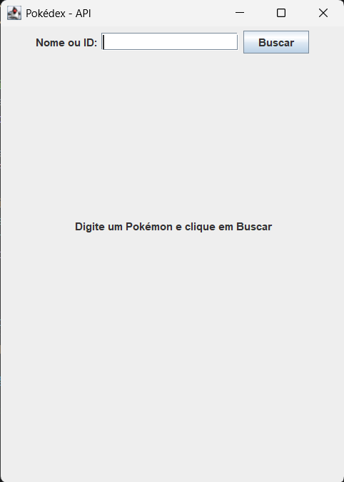
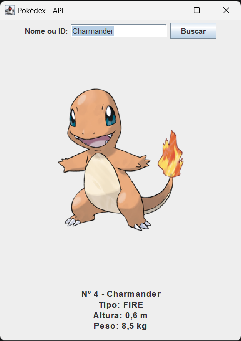

# Pokédex - Consumo de API REST

## 📖 Sobre o Projeto
Aplicação desktop desenvolvida em Java para o trabalho prático de Consumo de API REST com interface gráfica, para obtenção de notas subjetiva NP2 da cadeira de Programação de Computadores do Curso de Análise e Desenvolvimento de Sistemas do Centro Universitário UniAteneu. A aplicação permite consultar dados em tempo real, transformando respostas JSON em informações úteis numa interface visual.

## 🔌 API Utilizada
* **Nome da API:** PokéAPI
* **Endereço:** [https://pokeapi.co/](https://pokeapi.co/)

## ⚙️ Funcionalidades
* **Pesquisa de Dados:** Consulta de Pokémon introduzindo o Nome ou ID.
* **Processamento JSON:** Leitura e extração de atributos específicos (tipo, peso e altura) a partir do retorno da API.
* **Interface Gráfica:** Exibição clara dos dados e renderização automática da imagem oficial do Pokémon pesquisado na interface.
* **Tratamento de Erros:** Validação de campos, tratamento de falhas para pesquisas inexistentes (Erro 404) e identificação de bloqueios de rede (firewall corporativo) de forma a orientar o utilizador.

## 🚀 Instruções para Executar
1. Certifique-se de que tem o Java JDK (versão 17 ou superior) e o Maven instalados.
2. Abra a pasta do projeto numa IDE (como o VS Code, IntelliJ ou Eclipse).
3. Aguarde que o Maven descarregue as dependências configuradas no `pom.xml` (Gson).
4. Execute o ficheiro `Main.java` para iniciar a interface.
5. **Nota de Rede:** Caso esteja numa rede corporativa ou académica com restrições de firewall (como o Endian Firewall), ligue o computador temporariamente a uma rede móvel (4G/5G) para garantir que a ligação à PokéAPI não é intercetada.

## 📸 Capturas de Ecrã

* [Imagem da interface vazia / ecrã inicial]

* [Imagem de uma consulta bem-sucedida, ex: pesquisa do Charmander]

---
**Autor:** Leonardo Alves